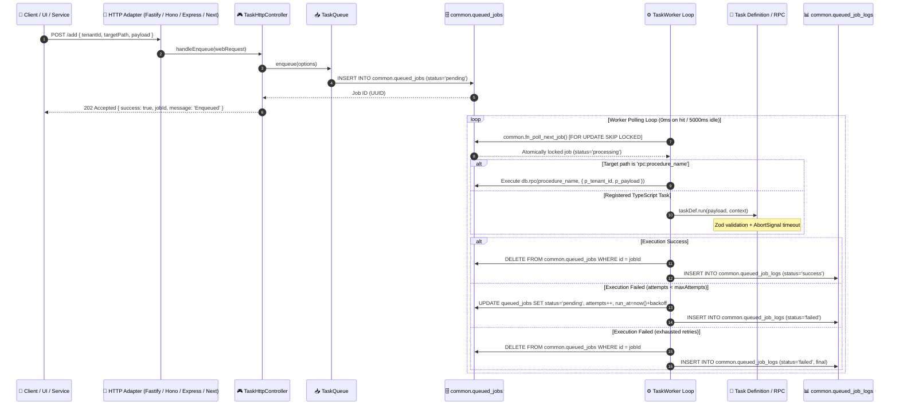
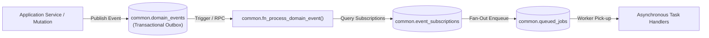

# Architecture Overview: `@shared/pg-task-engine`

`@shared/pg-task-engine` is a high-performance, decoupled asynchronous job queue, cron scheduler, and domain events engine built on top of **PostgreSQL** and TypeScript.

---

## 🏗️ Core Principles

1. **PostgreSQL as the Message Broker**:
   - Zero external broker dependencies (no Redis, BullMQ, RabbitMQ, or SQS to provision, pay for, and maintain).
   - Atomic multi-tenant ACID consistency: job enqueuing and database business transactions run in the same commit.
   - Non-blocking concurrent worker polling powered by PostgreSQL `FOR UPDATE SKIP LOCKED`.

2. **Web Standards First**:
   - The entire HTTP controller layer uses native `Request` and `Response` Web Fetch APIs.
   - Decoupled from runtime environments: runs identically in Node.js, Fastify, Express, Hono, Next.js App Router, or Edge environments.

3. **Inversion of Control & Injected Database Adapters**:
   - The engine does not dictate database client libraries.
   - Connectors for **Supabase**, **Prisma**, **Drizzle**, and raw **PostgreSQL (`pg` / `postgres.js`)** normalize queries while exposing the raw client in `TaskContext.db`.

4. **Hybrid Execution Model**:
   - **TypeScript Tasks**: Handlers defined with `defineTask`, validated by Zod schemas, and protected by cancellation tokens (`AbortSignal`).
   - **Direct Database RPCs**: Tasks prefixed with `rpc:` (e.g., `rpc:fn_reconcile_attendance`) execute directly inside the database via `db.rpc(...)`, bypassing Node.js data transfer overhead.

---

## 🔄 End-to-End Execution Flow

---

## 📦 Domain Events Outbox Architecture

1. Business transactions write events into `common.domain_events` within the same database commit.
2. `common.fn_process_domain_event` inspects `common.event_subscriptions` and fans out the event into isolated `common.queued_jobs` entries per matching target task.
3. Workers pick up each task independently, maintaining failure isolation across event consumers.
